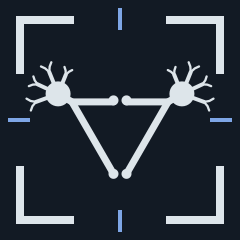

<p align="center"></p>

<h1 align="center">Nablaframe</h1>

<p align="center">A small GPT you can read.</p>

Nablaframe trains a small GPT from scratch on a Mac and makes the result legible. The training run and the forward pass can be replayed exactly, inspected through lenses, manipulated, and refactored, and every explanation it shows carries a measured faithfulness number. nanoGPT makes the code readable; Nablaframe aims to make the trained model readable.

## Report

The first technical report: [Nablaframe: Beating the Null Isn't Enough](https://grasphouse.pages.dev/posts/nablaframe-beating-the-null-isnt-enough.html). Its seed-round results and scripts are in the [evidence release](https://github.com/apolloh0/nablaframe/releases/tag/report-2026-11).

## Status

Phases 0 to 7 are complete. Each closed at a human gate that ruled on scripted measurements before the next phase began, and every ruling is in [docs/decisions.md](docs/decisions.md). Phase 8, a self-learning ledger, is next.

| Phase | Delivers | Ruled |
| --- | --- | --- |
| 0 | Backend, determinism and throughput gates; the trace schema; the mode-equality oracle | H0, 2026-09-29 |
| 1 | Reference model, trainer and trace engine | H1, 2026-10-02 |
| 2 | Read-only views and the training-timeline scrubber | 2026-10-04 (D16, D21) |
| 3 | Manipulation: ablate, patch, steer, swap | H3, 2026-10-05 |
| 4 | A ground-truth zoo of tasks with planted variables, and discrimination tests | H4, 2026-10-10 |
| 5 | Dictionaries (sparse autoencoders and a transcoder) and their edge-sparsity meter | H5, 2026-10-19 |
| 6 | Gestures: name-this-direction, assert-this-edge, open-this-up, generalize-this | H6, 2026-10-23 |
| 7 | Crystallize-this, with modular addition in the zoo | H7, 2026-11-07 |

From Phase 4 on, tools are tested on a zoo of tasks with planted variables. Each judged name and edge is reported beside a null and a random-weights twin, an untrained copy of the model. The gate reports are in [reports/](reports/).

## How it's built

- **The model:** a GPT-2-style transformer in JAX on CPU, the reference lane, with Equinox and Haliax for the model code and Optax for training. Layer-norm epsilon and attention scaling follow Levanter's GPT-2. Levanter and Haliax come from the Marin dev builds, pinned by `uv.lock`.
- **Replay:** training is deterministic on one machine. A run retrained from step 0 ends with an identical state hash.
- **Traces:** an append-only store of JSONL events and safetensors shards. Tap names follow TransformerLens's hook names.
- **Two more lanes:**
  - `metal`: metaljax on Apple Silicon, an accelerator probe.
  - `torch`: PyTorch, TransformerLens and the J-lens reference, for cross-checks.
- **The viewer:** one static HTML page in plain JavaScript, with no build step and no network. It re-hashes every tensor it shows against the trace.

## Quickstart

You need Python 3.12 or later, [uv](https://docs.astral.sh/uv/), and a CPU. The tests run on macOS or Linux. The gate scripts run on macOS only, and refuse to measure anywhere else.

```
git clone https://github.com/apolloh0/nablaframe
cd nablaframe
UV_PROJECT_ENVIRONMENT=.venv-jax uv sync --extra jax
UV_PROJECT_ENVIRONMENT=.venv-jax uv run --extra jax pytest -q
UV_PROJECT_ENVIRONMENT=.venv-jax uv run --extra jax python gates/phase4/g41_zoo_training.py --only induction
```

1. **Install** the reference lane into `.venv-jax`. Every lane command names its extra: without `--extra jax`, uv resyncs the lane to the base packages.
2. **Run the tests.** All 387 passed in about 13 minutes on a 2-core Linux machine.
3. **Train a zoo model** (macOS only). This trains the induction model (2 layers, 4,000 steps) and records its trace under `runs/phase4/induction/`. Then it retrains the model from step 0 and checks that the final state hash is identical. Both trainings together took just under 2 minutes on an M-series Mac. With `--only` it writes no report.

**Rebuilding the reports** (macOS): each gate script, in `gates/` (Phase 0) and `gates/phase1/` to `gates/phase7/`, says in its docstring how to run it. Together they rebuild [reports/](reports/).

**The viewer:** from the repo root run `python3 -m http.server`, then open `localhost:8000/viewer/`. It reads the reference run's trace store and views under `runs/`. Phase 1's and Phase 2's gate scripts write these (G1.6 and G2.6), after G1.4 trains the reference model on 100M tokens of TinyStories.

## Using Nablaframe

- **Test an interpretability method against planted variables.** Each zoo task declares the variables a model must compute (`src/nablaframe/zoo/declarations.py`). The gate scripts in `gates/phase4/` to `gates/phase7/` show how a tool is held to them, beside a null and the random-weights twin.
- **Study how a mechanism forms.** Training replays bit for bit, so any checkpoint can be rebuilt and compared exactly.
- **Add a task to the zoo** by writing its declaration.

Nablaframe isn't a general interpretability library for arbitrary pretrained models; that's a charter non-goal. It works at toy scale, on a CPU.

## Docs

- [Charter](docs/charter.md): goal, principles, scope, phases
- [Decisions](docs/decisions.md): every ruling, with its reason
- [Specs](docs/specs/): one per phase
- [Notebook](docs/notebook.md): findings, hypotheses and ideas, each tagged judged, recorded or feasibility

## License

- **Apache License 2.0** ([LICENSE](LICENSE)): everything in this repository except `docs/` and `reports/`.
- **CC BY 4.0** ([LICENSE-docs](LICENSE-docs)): `docs/` and `reports/`, except `docs/brand/`.
- **Not licensed:** the Nablaframe name and the logo files in `docs/brand/`.

## Name

∇ (nabla) is the gradient operator, and a frame is an overcomplete set of directions to read a representation against. The mark shows two neurons whose processes outline the ∇, meeting at synapses: the gaps where learning happens.
