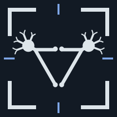

# Nablaframe: Charter

Nablaframe is a small GPT, trained from scratch on a Mac, whose training run and forward pass can be replayed, inspected, manipulated and refactored. Every explanation it shows carries a measured faithfulness number. It is the successor to Glasshouse, with a model where the program was.

This charter changes rarely. Any change needs a C-entry in [decisions.md](decisions.md).

## Goal

A research and learning instrument for how a transformer learns and computes. nanoGPT makes the code readable; Nablaframe aims to make the trained model and its training run readable.

## Non-goals

- Speed, scale, or frontier capability.
- A general interpretability library for arbitrary pretrained models.
- Claims about large-model phenomena. At this scale a global workspace is a hypothesis to test, and the expected result is a null.
- Open-ended self-improvement or autonomous research loops.

## Principles

Carried over from Glasshouse.

- **Trace as canonical output.** Every view is a pure decode of a typed, named-axis event log.
- **One evaluator, two modes.** The fast and instrumented forward passes are tied together by an equality oracle.
- **Trace once, decode forever.** Deterministic replay makes counterfactuals exact instead of estimated.
- **Honesty over cleverness.** No view ships until it recovers planted structure and comes up empty on a random-weights control. No view renders without its meter.
- **Crystallization is demonstrated over an envelope, never proven.** The gap is always shown.

## Scope for v1

| Area | In scope |
| --- | --- |
| Models | GPT-2-style, 1–30M parameters. Architecture dial: dense baseline, LayerNorm-free or element-wise norm, weight-sparse, bilinear MLP |
| Data | Ground-truth tasks (modular addition, induction, planted two-hop, Tracr-compiled models) and TinyStories with a word-level tokenizer of a few thousand tokens |
| Stack | JAX on CPU as reference; Haliax and Equinox model code; Levanter as a dependency; metaljax as optional accelerator; a PyTorch lane for TransformerLens and J-lens reference cross-checks |
| Views | Logit lens and J-lens slice views; attention, attribution and per-token loss; training-timeline scrubber; layer-structure dashboard |
| Dictionaries | Pluggable TopK SAE, Staircase SAE, Jacobian SAE (middle-layer MLPs, experimental) and transcoder, sharing one edge-sparsity meter |
| Manipulation | Ablate, patch, steer, J-lens coordinate swap, leave-a-batch-out replay |
| Gestures | Name-this-direction, assert-this-edge, generalize-this, crystallize-this, open-this-up |
| Self-learning | Test-time training and expert iteration on verifiable tasks, under a ledger with anchor results, lens diff, regression gate and revert. Promotion stays human |

## Phases

| Phase | Delivers | Spec |
| --- | --- | --- |
| 0 | Gates: backend, determinism, throughput, cross-check; trace schema; oracle harness | [specs/phase-0.md](specs/phase-0.md), done at H0 on 2026-09-29 |
| 1 | Reference model, trainer and trace engine; oracle wired in | [specs/phase-1.md](specs/phase-1.md), done at H1 on 2026-10-02 |
| 2 | Read-only views and the timeline scrubber | [specs/phase-2.md](specs/phase-2.md), done on 2026-10-04 (D16, D21) |
| 3 | Manipulation: ablate, patch, steer, swap | [specs/phase-3.md](specs/phase-3.md), done at H3 on 2026-10-05 (D28) |
| 4 | Ground-truth zoo and discrimination tests | [specs/phase-4.md](specs/phase-4.md), done at H4 on 2026-10-10 (D39) |
| 5 | Dictionaries and their edge-sparsity meter | [specs/phase-5.md](specs/phase-5.md), done at H5 on 2026-10-19 (D46) |
| 6 | Gestures on dictionary features: name-this-direction, assert-this-edge, open-this-up, generalize-this | [specs/phase-6.md](specs/phase-6.md), done at H6 on 2026-10-23 (D53) |
| 7 | Crystallization: crystallize-this, with modular addition in the zoo | [specs/phase-7.md](specs/phase-7.md) |
| 8 | Self-learning ledger | Not yet written |

Phase 4 precedes Phase 5 so nothing explanatory ships untested, and Phase 5's dictionaries precede Phase 6's gestures for the same reason: a gesture that names or connects features needs dictionaries already held to planted structure. Phase 7's crystallization comes after the gestures. A component is replaced by an explicit function only once the gestures have been tried on it: where they can say what it computes, the crystallization cites them, and where they can't, its own tests stand alone and its record says why. Each phase ends at a human gate, and nothing in the next phase starts before that gate is ruled.

## Done for v1

- [ ] Bit-exact replay on the reference backend, or a measured and pinned tolerance.
- [ ] Mode-equality oracle green.
- [ ] Every shipped view has passed its discrimination test and displays its meter.
- [ ] Signature demos: an induction head forming at the loss bump on the scrubber, and a planted two-hop intermediate swapped with the answer changing.
- [ ] One learned component crystallized into an explicit function, with its loss delta shown.
- [ ] One self-update logged, evaluated and reverted.
